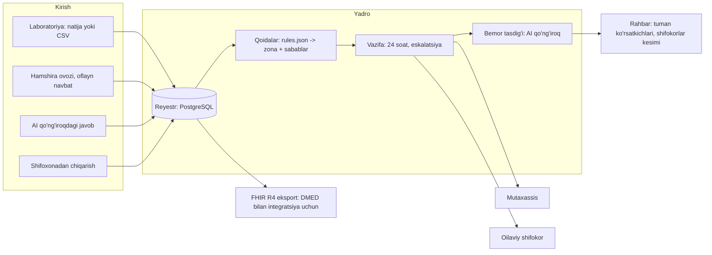

# Nigoh — ona va bola: xavf guruhini nazoratdan chiqarmaslik

Umummilliy AI Xakaton, Toshkent bosqichi, «Tibbiyot» treki. Sog'liqni saqlash vazirligi ro'yxatidagi uchta muammo bitta oqimda:

| № | Muammo | Nigoh nima qiladi |
|---|--------|-------------------|
| 9 | Homilador va chaqaloqlar monitoringi: tahlil yomonlashsa, mutaxassis kech biladi | Reyestr, «qizil / sariq / yashil» zonalar, soniyalar ichida bildirishnoma |
| 10 | Smartfon va internet yo'q qishloqlar | Hamshira ovoz bilan aytadi — AI kartani to'ldiradi (oflayn navbat bilan); AI bemorga o'zi qo'ng'iroq qiladi |
| 11 | Shifoxonadan chiqqan og'ir bemor nazoratsiz qoladi | «Faol chaqiruv»: 24 soatlik taymer, tasdiq, eskalatsiya, bemorning o'zi tasdiqlaydi |

## Qanday ishlaydi

`Signal → Ma'lumot → Zona → Vazifa → Nazorat`

1. **Signal**: laboratoriya tahlili, hamshiraning ovozi, AI qo'ng'iroqdagi javob, shifoxonadan chiqarish.
2. **Ma'lumot**: nutq → matn (VoiceLab STT, o'zbek/rus) → LLM maydonlarni ajratadi → **kod har bir iqtibosni matndan tekshiradi**; topilmagan maydon olib tashlanadi.
3. **Zona**: faqat qoidalar (`app/rules.json`) belgilaydi; har bir sabab qiymat, qoida va iqtibos bilan ko'rsatiladi. ML (RandomForest, UCI Maternal Health Risk) — faqat ikkinchi fikr.
4. **Vazifa**: mutaxassis yoki oilaviy shifokorga 24 soatlik taymer bilan.
5. **Nazorat**: shifokor tashrifni belgilaydi → AI bemordan «shifokor keldimi?» deb so'raydi → nomuvofiqlik rahbarga chiqadi.

Qo'ng'iroq ssenariylari — fayllar (`app/scenarios/*.json`): yangi bemor guruhi = yangi fayl, kod o'zgarmaydi.
Chaqaloq ssenariysi JSST jadvaliga tayanadi: 3-kun, 7–14-kun, 6-hafta; savollar — chaqaloqdagi xavf belgilari.

## Arxitektura



Qatlamlar bir-biridan ajratilgan:

| Qatlam | Fayl | Vazifasi |
|--------|------|----------|
| HTTP | `app/api/*.py`, `app/schemas.py` | Marshrutlar va Pydantic tekshiruvi; biznes-mantiq yo'q |
| Domen | `app/core.py` | Zonani qayta hisoblash, vazifalar, taymerlar, qo'ng'iroqlar, audit, CSV import |
| Qoidalar | `app/rules.py`, `app/rules.json` | Izohlanadigan zona qoidalari; chegaralar faylda |
| AI | `app/extract.py`, `app/voicelab.py`, `app/ml.py` | Ajratish + iqtibos tekshiruvi, STT/TTS/LLM mijozi, ML ikkinchi fikr |
| Integratsiya | `app/fhir.py`, `app/pdfgen.py` | FHIR Bundle, yo'llanma PDF |
| Ma'lumot | `app/db.py` | Modellar: patients, observations, risk_events, tasks, calls, notices, audit_log |
| Interfeys | `web/` | PWA, o'zbekcha va ruscha, bemor uchun qo'ng'iroq sahifasi |

## Biznes-qoidalar (kodda va testlarda)

- **Zona ko'tarilishi avtomatik, qizil zonadan tushishi — faqat mutaxassis ko'rigidan keyin.** Yaxshi tahlil kelsa ham, ochiq «Mutaxassis ko'rigi» vazifasi yopilmaguncha bemor qizil zonada qoladi.
- **Eskirgan o'lchovlar zonaga ta'sir qilmaydi** (`valid_days`, 45 kun).
- **Rozilik bo'lmasa — qo'ng'iroq yo'q.** AI qo'ng'iroq faqat rozilik qayd etilgan bemorga yaratiladi (409 `consent`).
- **Ikki tomonlama tasdiq.** Shifokor tashrifni belgilaydi → bemordan so'raladi → «kelmadi» javobi rahbarga nomuvofiqlik sifatida chiqadi.
- **Hech kim jim qolmaydi.** 7 kun aloqa yo'q — sariq, 14 kun — qizil; qo'ng'iroqqa 3 marta javob bo'lmasa — hamshiraga uyga borish vazifasi.
- **Muddat.** Vazifa 24 soatda yopilmasa, bir marta rahbarga eskalatsiya qilinadi (fon rejalashtiruvchi har daqiqada tekshiradi).
- **Shaxsiy hisoblar.** Har bir xodim o'z logini bilan kiradi (parol — tuzli PBKDF2 xesh, sessiya — imzolangan cookie). Rol hisobdan olinadi; oilaviy shifokor faqat o'z bemorlarining vazifalarini ko'radi.
- **Huquqlar rol bo'yicha.** Vazifani o'sha rol egasi (oilaviy shifokor — faqat o'z bemori bo'yicha) yoki rahbar yopadi; laboratoriya importi — rahbar va mutaxassis; namoyish ma'lumotlarini qayta yaratish va umumiy jurnal — faqat rahbar. Server shu qoidalarni tekshiradi, interfeys ruxsat etilmagan tugmalarni ko'rsatmaydi. Parol atrofidagi bo'shliqlar e'tiborga olinmaydi; ketma-ket noto'g'ri urinishlar vaqtincha cheklanadi.
- **Qo'ng'iroq yakuni.** Yakuniy so'zni Claude bemorning shu qo'ng'iroqdagi javoblari asosida yozadi, uni VoiceLab ovozi o'qiydi. Xavf bor-yo'qligini model emas, qoidalar hal qiladi. Matn aytilishidan oldin tekshiriladi (til, uzunlik, xavf holatida «bir yuz uch»); tekshiruvdan o'tmasa yoki javob kechiksa, ssenariydagi tayyor matn aytiladi. Modelga bemorning ismi, telefoni va manzili yuborilmaydi. `ANTHROPIC_API_KEY` bo'lmasa, tayyor matn ishlaydi. Bemorga nima aytilgani qo'ng'iroqlar ro'yxatida ko'rinadi.
- **Qo'ng'iroq suhbat kabi boshlanadi.** AI bemorni ismi va familiyasi bilan ataydi va «Men … bilan gaplashyapmanmi?» deb so'raydi (chaqaloq bo'yicha qo'ng'iroq — onasiga). Faqat «ha» javobidan keyin davom etadi. Boshqa odam olgan bo'lsa, sog'liq haqida hech narsa aytilmaydi: qo'ng'iroq xayrlashib tugaydi va urinish sifatida hisoblanadi (`app/talk.py`).
- **Bemorning o'z savollari.** Ssenariy savollaridan keyin bemor o'z so'zlari bilan savol beradi. Javob faqat poliklinika eslatmasidan olinadi (`app/advice.json`: har bir band JSSTning qaysi hujjatiga asoslanganini ko'rsatadi). Til modeli mos bandlarni tanlab, og'zaki nutqqa moslab aytadi va qaysi bandlardan foydalanganini ko'rsatishi shart; band ko'rsatilmagan, raqamli yoki boshqa tildagi javob aytilmaydi. Eslatmada javob bo'lmasa yoki savol bemorning tashxisi, tahlili, dorisi haqida bo'lsa, AI javob bermaydi: savol bemor biriktirilgan shifokorga muddatli vazifa bo'lib boradi. Bemor so'zida xavf belgisi bo'lsa, model so'ralmaydi: qoidalar odatdagi qizil yo'lni ishga tushiradi va bemorga 103 aytiladi. Har bir savol, javob, uni kim yozgani va manbasi qo'ng'iroq yozuvida saqlanadi. Eslatma matnini poliklinika shifokori tasdiqlashi kerak.
- **Audit.** Bemorga tegishli har bir yozuv `audit_log` ga hisob, rol va amal bilan tushadi.
- **Bildirishnomalar rol bo'yicha:** har kim o'zinikini, rahbar hammasini ko'radi. Sariq va qizil xabarlar Telegram'ga ham boradi: xodim profilidagi havola orqali o'z chatini bir martalik kod bilan ulaydi (`TELEGRAM_BOT_TOKEN` kerak).
- **Oddiy telefon raqamiga qo'ng'iroq.** `app/telephony.py` — Twilio bilan mos ovozli API uchun adapter: o'sha ssenariy fayli, savol audiosi `<Play>`, javob `<Record>` → STT. `TWILIO_*` sozlanmasa, qo'ng'iroq havola yoki QR orqali ochiladi.

## Texnologiyalar

FastAPI · Pydantic · SQLAlchemy · PostgreSQL · Docker Compose · VoiceLab (STT, TTS, LLM) · scikit-learn · ReportLab · HL7 FHIR R4 · PWA (service worker + IndexedDB oflayn navbat) · ruff · pytest · GitHub Actions.

## Ishga tushirish

```bash
cp .env.example .env        # VOICELAB_API_KEY va parollarni kiriting
docker compose up -d --build
docker compose exec app python -m scripts.eval   # kartani to'ldirish aniqligini o'lchash
docker compose exec app pytest -q                # testlar (VoiceLab kerak emas, alohida SQLite bazada)
```

API hujjati: `/api/docs`. Kalitsiz ham ishlaydi: nutq o'rniga matn kiritiladi, maydonlarni qoidalar ajratadi, qo'ng'iroqda tugmalar ishlaydi.

## O'lchovlar

- Kartani to'ldirish: 20 ta o'zbek va rus iborasida 113 maydondan 113 tasi to'g'ri (`scripts/eval.py`; iboralar sozlashda ishlatilgan, haqiqiy yozuvlarda qayta o'lchash kerak).
- ML ikkinchi fikr: 25% tekshiruv tanlanmasida aniqlik 83%, qizil zonani topish 87%.
- Qo'ng'iroqdagi bitta javob: taxminan 1 soniya (STT + tasniflash).

## Chegaralar

- Tashxis va davolash qarorini shifokor qabul qiladi; AI hisoblaydi, eslatadi, yetkazadi.
- AI qo'ng'iroqda o'zini AI deb tanishtiradi, tashxis qo'ymaydi va davo tayinlamaydi; umumiy parvarish bo'yicha faqat eslatmadagi maslahatni aytadi, xavf belgisida 103 ni aytadi.
- Eslatma (`app/advice.json`) JSST tavsiyalari asosida yozilgan; milliy klinik protokollar bilan solishtirilmagan va shifokor tomonidan hali tasdiqlanmagan. Telefon liniyasi (`app/telephony.py`) hozircha eski tartibda: ism bilan salomlashuv va erkin savollar faqat havola/QR orqali ochiladigan qo'ng'iroqda.
- Barcha ma'lumotlar sintetik. Ovoz yozuvi saqlanmaydi (transkripsiya olingach, o'chiriladi).
- To'rtta namoyish hisobi (`rahbar`, `mutaxassis`, `shifokor`, `hamshira`) bitta boshlang'ich parol bilan yaratiladi; ishchi versiyada kirish OneID/DMED orqali bo'ladi.
- Telefon liniyasi va Telegram kodi testlar bilan qoplangan, lekin jonli provayder va bot bilan hali sinalmagan: buning uchun hisob, raqam va token kerak.
- O'zbekcha matnlarni ona tili sohibi (shifokor) tekshirishi kerak.
- Sxema o'zgarsa, sintetik baza qayta yaratiladi; ishchi versiyada Alembic migratsiyalari ishlatiladi.
- Zona chegaralari — umumiy mo'ljal; yakuniy qiymatlarni shifokor milliy klinik protokol bo'yicha tasdiqlaydi.
- Haqiqiy telefon tarmog'i (SIP) ulanmagan: namoyishda qo'ng'iroq havola yoki QR orqali ochiladi; dialog mantig'i bir xil.
