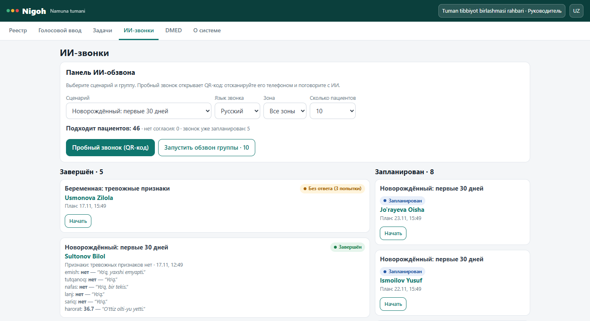
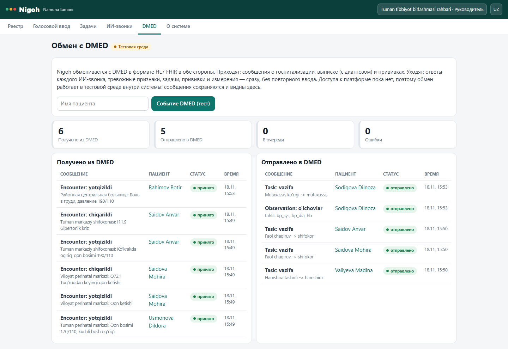
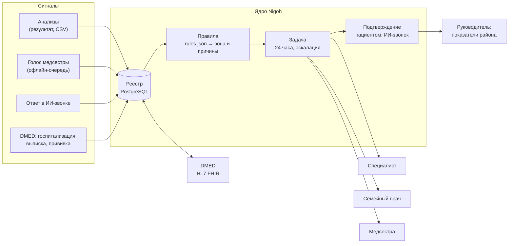

<div align="center">


# Nigoh

**ИИ-обзвон пациентов и реестр риска для поликлиники**

Беременные и новорождённые · прививки по календарю · диспансерный учёт · наблюдение после больницы · обмен с DMED по HL7 FHIR

[**Открыть демо**](https://nasa.cartify.ink) · [Документация](docs/README.md) · [Как устроен звонок](docs/calls.md) · [Интеграция с DMED](docs/dmed.md)


<sub>Национальный AI-хакатон, ташкентский этап · трек «Медицина» · 2026</sub>

</div>

---

## Зачем

Пациент из группы риска выпадает из поля зрения поликлиники: анализ ухудшился, а специалист узнал поздно; в селе нет смартфона и интернета; после больницы человека никто не спрашивает, как он. Nigoh закрывает три задачи из списка Министерства здравоохранения одним потоком и расширяет его на прививки и диспансерный учёт.

| № | Проблема | Что делает Nigoh |
|:-:|----------|------------------|
| 9 | Мониторинг беременных и новорождённых: ухудшение замечают поздно | Реестр с зонами «красная / жёлтая / зелёная», задача специалисту за секунды |
| 10 | Сёла без смартфонов и интернета | Медсестра надиктовывает — ИИ заполняет карту (с офлайн-очередью); ИИ сам звонит пациенту |
| 11 | Тяжёлый пациент после выписки остаётся без наблюдения | «Активный вызов»: таймер 24 часа, подтверждение, эскалация, звонок пациенту на следующий день |
| + | Пропущенные прививки, диспансерные группы | Календарь прививок по дате рождения, плановые опросы с отдельным согласием |

## Что умеет

- **Звонит как человек.** Здоровается по имени, спрашивает «вы — Дилноза Содикова?» и продолжает только после «да». Чужому человеку о здоровье ничего не говорит.
- **Задаёт вопросы только своему адресату.** Десять сценариев: беременность, новорождённый, прививки, после выписки (по диагнозу из DMED), диспансерный опрос. Сервер не даст позвонить пациенту с ВИЧ про детей, а маме — про лечение.
- **Отвечает на вопросы пациента** по памятке из 37 пунктов на основе документов ВОЗ — и обязан сослаться на пункт. Нет ответа в памятке или вопрос о диагнозе и лекарствах — вопрос уходит врачу задачей со сроком.
- **Решают правила, а не модель.** Зону риска считают правила из `rules.json`, каждая причина показана со значением и цитатой. Тревожный ответ — красная зона, задача специалисту и номер 103 пациенту.
- **Видит больницу через DMED.** Пациента экстренно увезли — участковый врач сразу видит, кого, когда, куда и почему. После выписки — звонок с вопросами под диагноз, ответы уходят врачу и в DMED.
- **Сам находит детей, которым пора на прививку**, и звонит маме: называет прививки и спрашивает, сделаны ли они. «Нет» — задача медсестре пригласить ребёнка.
- **Хранит тайну.** ВИЧ, ИППП, туберкулёз и гепатит видят только специалист, руководитель и лечащий врач; в звонке и уведомлениях диагноз не звучит; звонок возможен только после отдельного записанного согласия.
- **Пишет в DMED сразу**: ответы звонка, тревожные признаки, задачи, прививки, измерения, согласия — HL7 FHIR, сопоставление по ПИНФЛ.

## Скриншоты

<sub>Интерфейс на русском (есть и узбекский), данные синтетические.</sub>


<table>
  <tr>
    <td width="62%"><br><sub><b>Карточка пациентки.</b> Почему зона красная — правило, значение, источник; задача специалисту с таймером 24 часа; запланированный ИИ-звонок; что ушло в DMED.</sub></td>
    <td width="38%" align="center"><br><sub><b>Звонок у пациентки</b> — по ссылке или QR-коду, без приложения.</sub></td>
  </tr>
  <tr>
    <td><br><sub><b>Панель ИИ-обзвона.</b> Сценарий, язык, зона — система сама считает, кому звонить, кому нельзя без согласия и кому звонок уже назначен.</sub></td>
    <td align="center"><br><sub><b>События из больниц через DMED:</b> кого, куда, когда, почему, кто доставил; диагноз при выписке.</sub></td>
  </tr>
  <tr>
    <td><br><sub><b>Обмен с DMED</b> в формате HL7 FHIR: что пришло и что ушло; щелчок по строке показывает сам ресурс.</sub></td>
    <td align="center"><br><sub><b>Реестр:</b> красная зона сверху, главная причина, последний контакт, фильтры по группам.</sub></td>
  </tr>
</table>

## Как это работает

`Сигнал → Данные → Зона → Задача → Контроль`



1. **Сигнал** — анализ из лаборатории, голос медсестры, ответ в звонке, событие из больницы.
2. **Данные** — речь → текст (VoiceLab, узбекский и русский) → языковая модель выделяет поля → **код проверяет каждую цитату по исходному тексту**, поле без цитаты отбрасывается.
3. **Зона** — только правила; ML-модель (RandomForest на UCI Maternal Health Risk) — лишь второе мнение.
4. **Задача** — специалисту, семейному врачу или медсестре с таймером; просрочка — эскалация руководителю.
5. **Контроль** — врач отметил визит → ИИ спрашивает пациента «врач приходил?» → расхождение видит руководитель.

## Пример звонка

Сценарий «Беременная: тревожные признаки», реплики ИИ — из кода:

> **ИИ:** Здравствуйте! Вам звонит Nigoh — помощник поликлиники на основе искусственного интеллекта. Скажите, пожалуйста, вы — Содикова Дилноза?
> **Пациентка:** Да, я.
> **ИИ:** Спасибо, Дилноза. Задам пять коротких вопросов о вашем самочувствии. Отвечайте «да» или «нет». В конце вы сможете задать свои вопросы. Была ли в последние дни сильная головная боль?
> **Пациентка:** Нет.
> **ИИ:** … Есть ли отёки на ногах, руках или лице?
> **Пациентка:** Да, ноги отекают.
> *Правило: отёки у беременной — тревожный признак. Зона пересчитана, специалисту ушла задача, в DMED — `Flag`.*
> **Пациентка** *(в конце)*: Что мне лучше есть во время беременности?
> **ИИ:** *Отвечает своими словами по пункту памятки о питании (ВОЗ) и записывает, на какой пункт опирался. Вопрос о диагнозе или лекарствах ушёл бы врачу:* «На этот вопрос лучше ответит ваш врач. Я передала ему ваш вопрос, он свяжется с вами».
> **ИИ:** В ваших ответах есть тревожные признаки. Пожалуйста, сейчас же позвоните по номеру сто три. Вашему врачу отправлено срочное сообщение.

Подробно — в [docs/calls.md](docs/calls.md).

## Сценарии звонков

Сценарий — это JSON-файл в [`app/scenarios/`](app/scenarios): новая группа пациентов — новый файл, код не меняется.

| Сценарий | Кому | О чём спрашивает |
|----------|------|------------------|
| `homilador` | беременной | головная боль, зрение, отёки, кровотечение, шевеления плода |
| `homilador_ahvol` | беременной | самочувствие, сон, настроение, приём витаминов |
| `chaqaloq_30kun` | маме новорождённого | сосание, судороги, дыхание, вялость, желтуха, температура |
| `chiqarishdan_keyin` | родильнице после выписки (O00–O99) | температура, кровотечение, ухудшение, лекарства |
| `emlash` | родителю ребёнка, которому пора на прививку | сделана ли прививка, реакция, болеет ли, придёт ли |
| `chiqarish_yurak` | после больницы с диагнозом I00–I99 | боль в груди, одышка, отёки, лекарства |
| `chiqarish_nafas` | после больницы с диагнозом J00–J99 | температура, одышка, кашель, лекарства |
| `chiqarish_umumiy` | после больницы, остальные диагнозы | температура, боль, ухудшение, лекарства |
| `dispanser` | пациенту на диспансерном учёте, с отдельным согласием | лекарства, пропущенный осмотр, побочные эффекты, самочувствие |
| `tashrif_tasdiq` | любому пациенту после визита | приходил ли врач, понятны ли объяснения |

## Структура проекта

```text
nigoh/
├── app/                    серверная часть (FastAPI)
│   ├── api/                HTTP-маршруты: пациенты, задачи, звонки, DMED, телефония
│   ├── scenarios/          сценарии звонков (JSON)
│   ├── core.py             предметная логика: зоны, задачи, таймеры, звонки, аудит
│   ├── rules.py · rules.json         объяснимые правила зон, пороги в файле
│   ├── talk.py · dialogue.py         живой разговор: приветствие, проверка личности, ответы
│   ├── closing.py          заключительные слова звонка (Claude / VoiceLab)
│   ├── extract.py          поля из речи + проверка цитат
│   ├── dmed.py · exchange.py         обмен с DMED по HL7 FHIR
│   ├── vaccines.py · vaccines.json   календарь прививок
│   ├── groups.json         диспансерные группы и признак конфиденциальности
│   ├── advice.json         памятка для ответов пациенту (ВОЗ)
│   ├── db.py · seed.py     модели данных и синтетическая база
│   └── …                   речь (voicelab.py), телефония, Telegram, PDF, ML
├── web/                    интерфейс: PWA на чистом JS, узбекский и русский
├── tests/                  27 тестов предметных правил (pytest)
├── scripts/eval.py         замер точности заполнения карты
├── gateway/                стенд «Android-телефон с SIM-картой» для звонков на обычные номера
├── deploy/                 выкладка без сборки образа, с откатом
├── docs/                   документация
├── Dockerfile · docker-compose.yml
└── .env.example            все настройки с пояснениями
```

## Быстрый старт

```bash
cp .env.example .env              # задайте пароли; ключ VoiceLab — по желанию
docker compose up -d --build      # приложение на http://localhost:18700
docker compose exec app pytest -q # тесты: без VoiceLab, на отдельной SQLite
```

При первом запуске создаётся синтетическая база: 400 пациентов, четыре учётные записи — `rahbar` (руководитель), `mutaxassis` (специалист), `shifokor` (семейный врач), `hamshira` (медсестра). Документация API — `/api/docs`.

Без ключей всё работает: вместо речи вводится текст, поля выделяют правила, в звонке работают кнопки. Подробнее — [docs/deploy.md](docs/deploy.md).

## Замеры

| Что | Результат |
|-----|-----------|
| Заполнение карты по речи | 113 из 113 полей на 20 фразах (узбекский и русский), `scripts/eval.py`; фразы использовались при настройке — на реальных записях замер нужно повторить |
| ML — второе мнение | точность 83 %, полнота по красной зоне 87 % (25 % отложенной выборки) |
| Один ответ в звонке | около 1 секунды (распознавание + классификация) |
| Ответ сайта под нагрузкой демо | 0,1–0,6 с |

## Честно об ограничениях

- Диагноз и лечение назначает врач. ИИ считает, напоминает, доносит; в звонке представляется ИИ и при тревожном признаке называет 103.
- **DMED** — подключения к настоящей платформе нет: dhp.uz пускает только зарегистрированных клиентов. Готово всё, кроме доступа; пока работает тестовая среда внутри системы.
- **Памятка и календарь прививок** составлены по документам ВОЗ и опубликованному календарю Минздрава; врач их ещё не утвердил, с действующим приказом не сверены.
- **Узбекские тексты** звонков должен вычитать носитель языка.
- **Обычные телефонные номера**: адаптер для голосового API и стенд с Android-телефоном готовы, с живым оператором связи не проверены. На демо звонок открывается по ссылке или QR-коду — логика диалога та же.
- Все данные синтетические. Запись голоса не хранится: после расшифровки удаляется.

## Документация

| Документ | О чём |
|----------|-------|
| [Архитектура](docs/architecture.md) | слои, модули, модель данных, фоновые процессы |
| [ИИ-звонок](docs/calls.md) | ход разговора, сценарии, ответы по памятке, заключительные слова |
| [Интеграция с DMED](docs/dmed.md) | какие FHIR-ресурсы приходят и уходят, сопоставление, журнал |
| [Конфиденциальность и доступ](docs/privacy.md) | роли, диспансерные группы, отдельное согласие |
| [Правила предметной области](docs/rules.md) | зоны, сроки, эскалации, прививки, больничные события |
| [Запуск и выкладка](docs/deploy.md) | локальный запуск, переменные окружения, выкладка на сервер |
| [Звонки через телефон с SIM](gateway/README.md) | стенд на Android-телефоне |

## Технологии

FastAPI · Pydantic · SQLAlchemy · PostgreSQL · Docker Compose · VoiceLab (STT, TTS, LLM) · Claude · scikit-learn · ReportLab · HL7 FHIR · PWA (service worker, офлайн-очередь в IndexedDB) · pytest · ruff
