# Архитектура

Nigoh — одно приложение FastAPI с базой PostgreSQL и интерфейсом на чистом JavaScript. Внешние сервисы (VoiceLab, Claude, DMED, Telegram, голосовой API) необязательны: без них система работает, просто с меньшими возможностями.

```mermaid
flowchart TB
  subgraph CL0["Клиенты"]
    W["Интерфейс сотрудников<br/>web/app.js — PWA"]
    P["Страница звонка пациента<br/>web/call.js — по ссылке или QR"]
    G["Стенд с SIM-картой<br/>gateway/gateway.py"]
  end
  subgraph APP["Приложение (FastAPI)"]
    A["app/api/* — маршруты и проверка входных данных"]
    C["app/core.py — предметная логика"]
    R["app/rules.py — зоны"]
    T["app/talk.py · dialogue.py — разговор"]
    X["app/dmed.py · exchange.py — FHIR"]
    S["Планировщик: раз в минуту"]
    O["Отправка в DMED:<br/>после каждого сохранения"]
  end
  DB[("PostgreSQL")]
  VL["VoiceLab<br/>STT · TTS · LLM"]
  CL["Claude"]
  DM["DMED"]
  W & P & G --> A --> C
  C --> R & T & X
  C <--> DB
  T --> VL & CL
  X --> O --> DM
  DM --> A
  S --> C
```

## Слои

| Слой | Файлы | Что делает |
|------|-------|------------|
| HTTP | `app/api/*.py`, `app/schemas.py` | маршруты и проверка Pydantic; предметной логики здесь нет |
| Предметная логика | `app/core.py` | пересчёт зоны, задачи и таймеры, звонки и их адресаты, события из больниц, аудит, импорт анализов |
| Правила | `app/rules.py`, `app/rules.json` | объяснимые правила зон; пороги — в файле, а не в коде |
| Разговор | `app/talk.py`, `app/dialogue.py`, `app/closing.py` | приветствие, проверка личности, вопросы сценария, ответы по памятке, заключительные слова |
| Речь и ИИ | `app/voicelab.py`, `app/extract.py`, `app/ml.py` | клиент VoiceLab, выделение полей с проверкой цитат, второе мнение ML |
| Справочники | `app/scenarios/*.json`, `app/advice.json`, `app/vaccines.json`, `app/groups.json` | сценарии, памятка, календарь прививок, диспансерные группы |
| Интеграции | `app/dmed.py`, `app/exchange.py`, `app/fhir.py`, `app/telephony.py`, `app/simline.py`, `app/telegram.py`, `app/pdfgen.py` | DMED, экспорт FHIR, голосовой API, стенд с SIM, Telegram, направление в PDF |
| Данные | `app/db.py`, `app/seed.py` | модели и синтетическая база |
| Интерфейс | `web/` | PWA для сотрудников и страница звонка для пациента, узбекский и русский |

## Модель данных

| Таблица | Что хранит |
|---------|------------|
| `patients` | пациент: группа (беременная, родильница, новорождённый, ребёнок, диспансерный), ПИНФЛ, пол, участок и врач, зона, диспансерные группы, согласия |
| `observations` | измерения и анализы: значение, источник, цитата, автор |
| `risk_events` | каждое изменение зоны с причинами |
| `tasks` | задачи сотрудникам: роль, срок, статус, эскалация |
| `calls` | ИИ-звонки: сценарий, ответы, разговор с пациентом, заключительные слова, контекст (прививки, больница) |
| `hospitalizations` | пребывания в больнице: куда, когда, кто доставил, диагноз МКБ-10, рекомендации |
| `vaccinations` | прививки: из DMED (подтверждены) или со слов родителя |
| `dmed_messages` | журнал обмена с DMED: направление, ресурс, статус, ошибка |
| `notices` | уведомления сотрудникам по ролям |
| `audit_log` | кто, когда и что сделал с данными пациента |
| `users` | учётные записи сотрудников |

## Фоновые процессы

- **Планировщик** (раз в минуту): просроченные задачи эскалирует руководителю, «молчащих» пациентов переводит в жёлтую и красную зону.
- **Отправка в DMED**: просыпается после каждого сохранения в базе и ещё раз в 20 секунд; недоставленное остаётся в очереди.
- **Озвучка фраз сценариев** при старте: звонок не ждёт синтеза речи.

## Защита от перегрузки

Экраны сами обновляют списки каждые 12–20 секунд. Вкладка со старой версией интерфейса однажды засыпала сервер запросами, поэтому:

- списки и карточка пациента отдаются из снимка, живущего 3 секунды;
- вкладка, которая шлёт больше 40 запросов за 10 секунд на один адрес, получает «войдите заново» и минуту отказа;
- пул соединений с базой — 20 + 20, проверка `/api/health` не ходит в базу.

## API

Полное описание — `/api/docs` (Swagger). Основные группы:

| Префикс | Назначение |
|---------|------------|
| `/api/login`, `/api/me` | вход и учётная запись |
| `/api/dashboard`, `/api/meta` | показатели района, справочники |
| `/api/patients` | реестр, карточка, измерения, выписка, согласия, создание звонка, направление PDF, экспорт FHIR |
| `/api/tasks`, `/api/calls` | задачи и ИИ-звонки, аудитория и запуск обзвона |
| `/api/call/{token}` | страница звонка пациента: реплики, ответы, вопросы, завершение |
| `/api/dmed` | приём FHIR из DMED, журнал, тестовые события |
| `/api/gateway`, `/api/tel` | стенд с SIM-картой и голосовой API |
