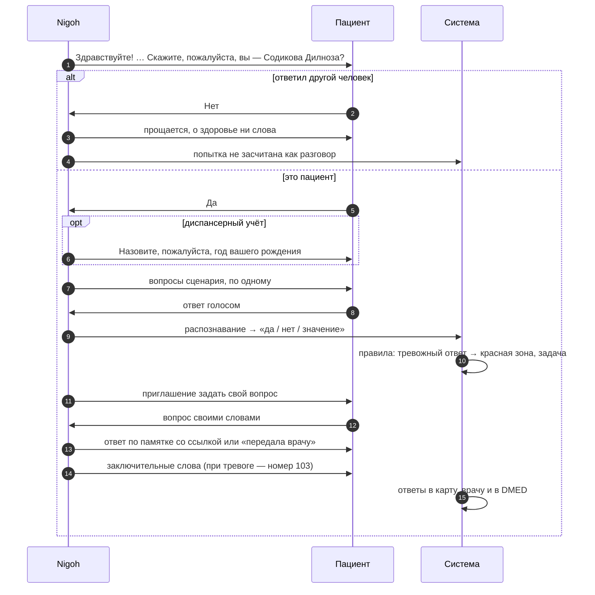

# ИИ-звонок

Звонок открывается по ссылке или QR-коду (страница `web/call.html`), через стенд с SIM-картой или через голосовой API. Логика разговора одна и та же: `app/talk.py`, `app/dialogue.py`, `app/api/public.py`.

## Ход разговора

## Приветствие и проверка личности

- ИИ называет себя помощником поликлиники на основе искусственного интеллекта и спрашивает: «Скажите, пожалуйста, вы — {фамилия и имя}?». Звонок о новорождённом или о прививке идёт маме.
- Пока человек не сказал «да», о здоровье не говорится ничего. Ответ «нет» — вежливое прощание; звонок считается попыткой.
- Пациенту на диспансерном учёте после имени задаётся второй вопрос — год рождения. Не совпал — звонок заканчивается так же, как с чужим человеком.
- После подтверждения ИИ благодарит по имени (по-узбекски — с «opa» или «aka»), объясняет, о чём звонок (какие прививки подошли, «узнать, как вы после выписки»), и предупреждает, что в конце можно задать свои вопросы.

## Сценарии

Каждый сценарий — JSON-файл в `app/scenarios/`: заголовок, кому он предназначен (`who`), коды МКБ-10 для звонков после больницы (`icd`), признак конфиденциальности (`private`), вступление, вопросы и заключительные фразы на узбекском и русском. У вопроса есть тип (`yesno`, число, выбор), тревожный ответ (`flag_if`) и условие показа (`if`) — например, вопрос о реакции на прививку задаётся, только если прививку сделали.

Кто какой сценарий может получить, решает сервер (`core.fits`, `core.allowed`). Неподходящий звонок не создаётся — ответ 409:

| Адресат | Сценарии |
|---------|----------|
| беременная | `homilador`, `homilador_ahvol` |
| родильница после выписки | `chiqarishdan_keyin` |
| новорождённый (звонок маме) | `chaqaloq_30kun` |
| ребёнок, которому пора на прививку (звонок родителю) | `emlash` |
| выписанный из больницы | `chiqarish_yurak` (I00–I99), `chiqarish_nafas` (J00–J99), `chiqarish_umumiy` (остальные) |
| пациент на диспансерном учёте с отдельным согласием | `dispanser` |
| любой пациент после визита врача | `tashrif_tasdiq` |

## Ответы на вопросы пациента

1. ИИ приглашает задать вопрос и называет только то, что касается этого человека: беременную — о беременности, маму — об уходе за малышом, диспансерного пациента — о лечении и наблюдении.
2. Если в словах есть тревожный признак, модель не спрашивают: правила запускают обычный «красный» путь, пациенту называют 103.
3. Иначе языковая модель получает пронумерованные пункты памятки `app/advice.json` (37 пунктов, у каждого — документ ВОЗ, на котором он основан, и группы, которым он подходит) и должна ответить только по ним, начав со ссылки `[n]`. Нет подходящего пункта — ответ `TOPILMADI`.
4. Ответ проверяется: есть ссылка на существующий пункт, язык тот же, без цифр и без лишней длины. Не прошёл проверку, нет пункта или вопрос о диагнозе, анализах, лекарствах — ИИ говорит, что передал вопрос врачу, и врачу уходит задача со сроком.
5. Каждый вопрос, ответ, автор ответа (какая модель) и пункты памятки сохраняются в звонке.

Ответ пишут параллельно две модели (VoiceLab и Claude); звучит первый прошедший проверку.

Первородящей и родильнице с первым ребёнком в конце предлагаются короткие советы: ИИ спрашивает, рассказать ли, и зачитывает 3–4 главных пункта памятки.

## Заключительные слова

Заключение пишет Claude по ответам этого звонка — и только по ним; на других языках и при опоздании Claude — модель VoiceLab. Есть ли риск, решают правила, а не модель. Перед тем как сказать текст, код проверяет язык и длину, а при тревоге — что в тексте есть «сто три». Не прошёл проверку или опоздал — звучит готовая фраза из сценария. Имя, телефон и адрес пациента в модель не передаются.

## Что попадает к врачу

- Ответы и тревожные признаки — в карту пациента, зона пересчитывается.
- Задачи: специалисту при тревоге, семейному врачу на вопрос пациента, медсестре — пригласить на прививку, если её не сделали.
- Всё это сразу уходит в DMED: `QuestionnaireResponse`, `Flag`, `Task`, `Immunization` ([подробно](dmed.md)).
