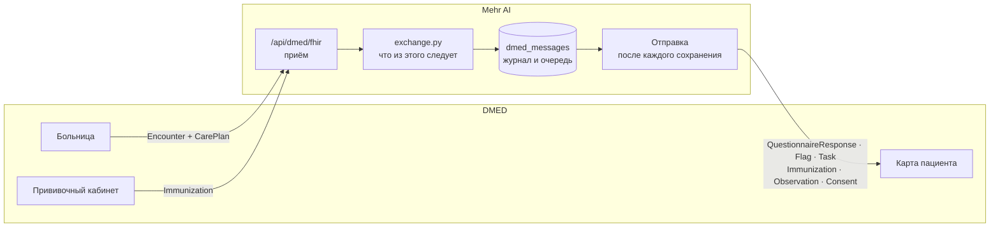

# Интеграция с DMED

DMED — национальная цифровая платформа здравоохранения. Mehr AI обменивается с ней в обе стороны в формате HL7 FHIR, как требует руководство платформы (dhp.uz, FHIR R5; ресурсы R4 тоже читаются). Код — `app/dmed.py` (форматы и очередь отправки), `app/exchange.py` (что делать с пришедшим), `app/api/dmed.py` (маршруты).

## Что приходит

| Ресурс | Событие | Что делает Mehr AI |
|--------|---------|------------------|
| `Encounter` (открытый) | пациента госпитализировали | лечащий врач сразу видит: кого, когда, в какую больницу, почему, экстренно ли, кто доставил |
| `Encounter` (закрытый) + `CarePlan` | выписка с диагнозом МКБ-10 и рекомендациями | диагноз в карту, «Активный вызов» врачу, звонок на следующий день с вопросами под диагноз |
| `Immunization` | ребёнку сделали прививку | доза отмечается подтверждённой; слова родителя заменяются записью кабинета |

Пациент находится по ПИНФЛ (система идентификатора — `DMED_PINFL_SYSTEM`), если номера нет — по полному имени. Код МКБ-10 из выписки ещё и относит пациента к диспансерной группе (`app/groups.json`).

Приём: `POST /api/dmed/fhir`, заголовок `X-Dmed-Key` должен совпадать с `DMED_INBOUND_KEY`.

## Что уходит

| Ресурс | Когда |
|--------|-------|
| `QuestionnaireResponse` | закончен ИИ-звонок: все ответы сценария |
| `Flag` | в ответах или измерениях тревожный признак |
| `Task` | сотруднику поставлена задача, в том числе вопрос пациента врачу |
| `Immunization` (`reported`) | родитель сказал в звонке, что прививку сделали |
| `Observation` (Bundle) | медсестра надиктовала измерения, пришёл анализ; коды LOINC |
| `Consent` | записано отдельное согласие на звонки о диспансерном наблюдении |

Каждый ресурс ставится в очередь в той же транзакции, что и изменение, которое его породило, и уходит сразу после сохранения. Если связи нет, сообщение ждёт следующего круга; отказ платформы сохраняется вместе с сообщением. Журнал содержит диагнозы, поэтому открыт только руководителю и специалисту.

## Тестовая среда

Пока не заданы `DMED_BASE_URL` и `DMED_TOKEN`, тот же код работает с тестовой средой внутри системы («sinov muhiti»):

- всё, что ушло бы в DMED, видно на странице «DMED» (руководитель и специалист) понятными словами: событие, пациент, главные факты; щелчок по строке открывает подробности, исходный FHIR-ресурс — по кнопке;
- событие из больницы или прививку можно отправить вручную из карточки пациента: «Событие DMED (тест)» → `POST /api/dmed/simulate`;
- на странице «Маршрут пациента» у каждого пациента своя тестовая медкарта DMED: госпитализация, выписка, план прививок и ответы опросов — отдельно от реестра (`app/carepath.py`, `/api/care`).

## Что нужно для подключения к настоящей платформе

1. Зарегистрировать клиента на сервере входа платформы и получить токен (`DMED_TOKEN`).
2. Указать адрес FHIR (`DMED_BASE_URL`) и ключ входящих событий (`DMED_INBOUND_KEY`).
3. Взять из руководства систему идентификатора ПИНФЛ (`DMED_PINFL_SYSTEM`).
4. Сверить ресурсы с профилями платформы (FHIR R5) и подписаться на события госпитализации, выписки и прививок.

С настоящей платформой обмен ещё не проверялся: доступа нет.
