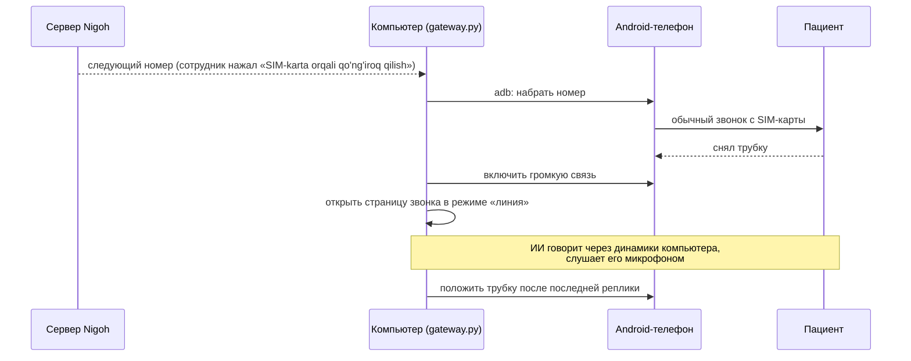

# Звонки через телефон с SIM-картой

Стенд, с которым ИИ-звонок уходит на обычный номер: Android-телефон с SIM-картой подключён к компьютеру по USB, компьютер говорит и слушает за ИИ.



## Что нужно

- Компьютер с Python 3, Edge или Chrome, динамиком и микрофоном.
- Android-телефон с SIM-картой, включённой отладкой по USB и кабелем.
- `adb` из Android platform-tools: по умолчанию ищется в `gateway/platform-tools/adb.exe`, другой путь — `--adb`.
- Ключ стенда: тот же, что в `GATEWAY_KEY` на сервере, в файле `gateway/gateway.key` (или `--key`).

## Запуск

```bash
python gateway/gateway.py --check      # что отвечают телефон и сервер, и выход
python gateway/gateway.py --dry-run    # без телефона и браузера: проверка серверной части
python gateway/gateway.py              # звонить по-настоящему
```

| Параметр | Что задаёт |
|----------|------------|
| `--server` | адрес сервера Nigoh (по умолчанию — демо) |
| `--ring-seconds` | сколько ждать ответа, по умолчанию 45 с |
| `--talk-seconds` | наибольшая длина звонка, по умолчанию 420 с |
| `--no-speaker` | не включать громкую связь (если звук идёт по кабелю гарнитуры) |
| `--page` | настройки страницы звонка, например `vad=4` для тихой линии |
| `--once` | остановиться после одного звонка |

## Ограничение

Набор номера и громкая связь работают, но голос ИИ доходит до собеседника только через воздух: телефон на громкой связи рядом с колонкой и микрофоном компьютера. Чистый звук даст либо Bluetooth (компьютер как гарнитура телефона и виртуальный звуковой кабель), либо кабель с переходником USB-C. Ни один из вариантов пока не проверен с живым звонком.
